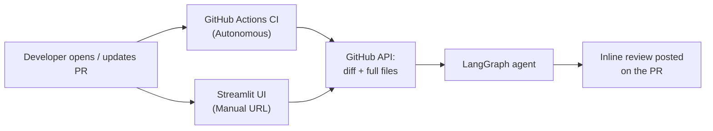
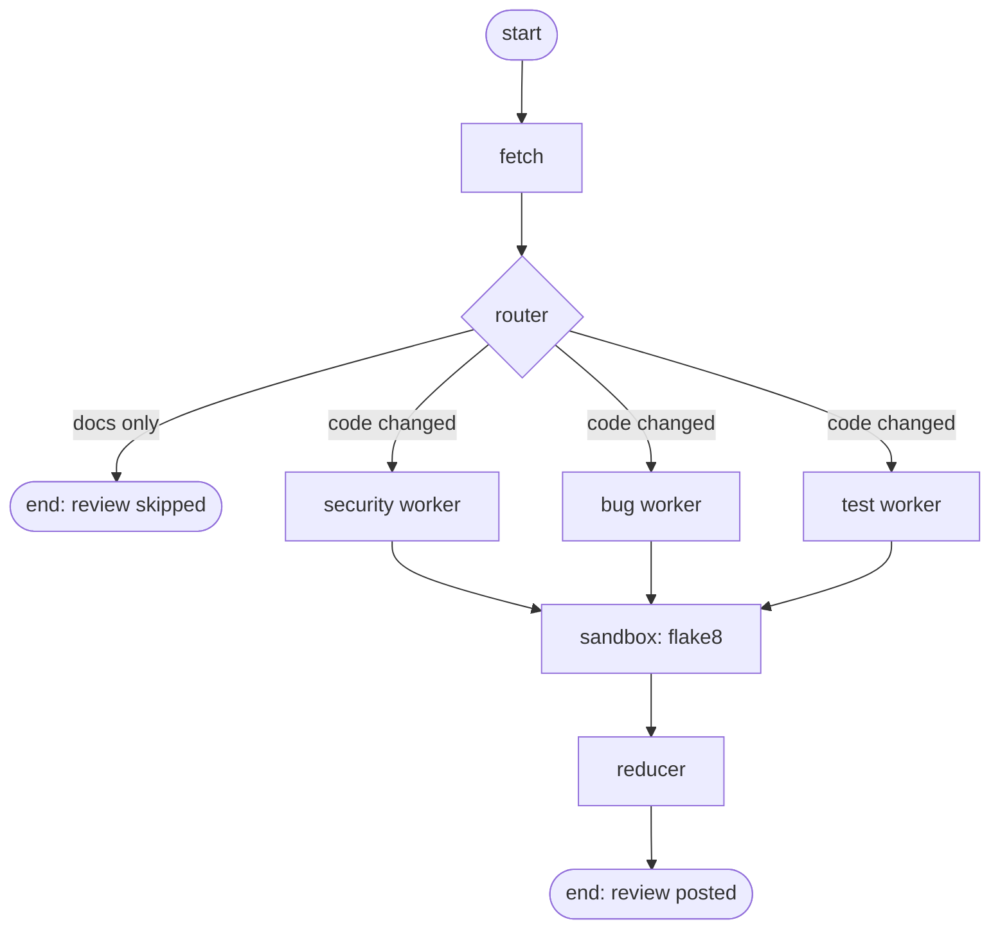
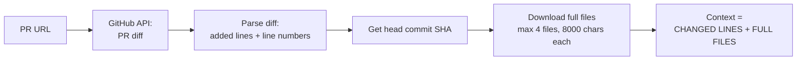
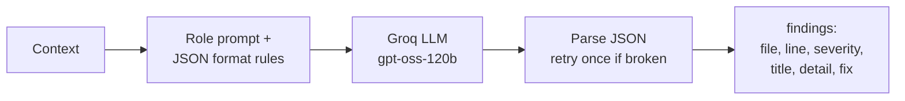
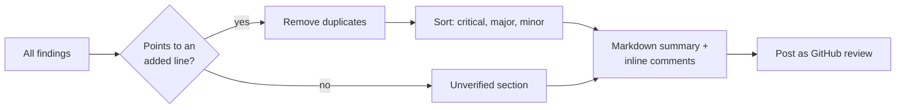

# 🐙  PR Review Agent

An automated AI code reviewer for GitHub Pull Requests. It runs **automatically via GitHub Actions** whenever a PR is opened or updated—or on-demand via the **Streamlit UI**—reading changed code, running `flake8`, and posting inline review comments on the exact lines.

Built with **LangGraph**, **Groq (gpt-oss-120b)**, **Streamlit** and the **GitHub API**. Traced with **LangSmith**.

> The agent is an **assistant**, not a replacement for a human reviewer. It does the first pass (secrets, obvious bugs, style) so humans can focus on design and business logic.

---

## Table of contents

1. [What does it do?](#what-does-it-do)
2. [Demo](#demo)
3. [Architecture](#architecture)
4. [Step by step: what happens to one PR](#step-by-step-what-happens-to-one-pr)
5. [Example review](#example-review)
6. [Features](#features)
7. [Tech stack](#tech-stack)
8. [Project structure](#project-structure)
9. [Setup](#setup)
10. [How to use](#how-to-use)
11. [Evaluation and test results](#evaluation-and-test-results)
12. [Design decisions and lessons learned](#design-decisions-and-lessons-learned)
13. [Limitations](#limitations)

---

## What does it do?

When a developer opens a Pull Request, someone has to review it. Many review comments are repetitive: a hardcoded API key, an unused import, a missing empty-list check.

This agent automates that first round:

1. You paste the PR link.
2. It downloads the PR changes and the full files.
3. Three AI workers check **security**, **bugs** and **tests** in parallel.
4. A real linter (**flake8**) checks code style.
5. A reducer merges everything, removes unreliable findings, and posts the review on the PR.

**In one line:** `PR link → fetch → code or docs? → 3 reviewers in parallel → flake8 → merge → comment on the PR`

---

## Demo

| Step | Screenshot |
|---|---|
| Streamlit app | `docs/app.png` |
| Review posted on the PR (inline comments) | `docs/pr-review.png` |
| LangSmith trace of one run | `docs/langsmith.png` |

> ### Live: https://pr-reviewagent.streamlit.app/

> Add your screenshots to a `docs/` folder and update the paths above.
> [](https://github.com/marketplace/actions/ai-pr-review-agent)

---

## Architecture

The system has three parts: **fetching** (getting the PR), the **LangGraph flow** (deciding what to do), and the **review** (what happens inside a worker and the reducer).

### 1. End to end



### 2. LangGraph flow: every PR goes through the router



- The **router** skips the whole review if every changed file is a doc (`.md`, `.txt`, `.rst`). No LLM calls, no cost.
- The **three workers run in parallel**, so the review takes seconds, not minutes.
- The **sandbox** step waits for all three workers, then runs the linter.

### 3. Fetch: what the agent reads



The workers see two things: the **changed lines** (with line numbers) to review, and the **full files** only as background context.

### 4. Inside one worker



### 5. Inside the reducer (plain Python, no LLM)



The reducer is **deterministic code**, not an LLM. This makes the output predictable and prevents the model from inventing or rewording findings.

---

## Step by step: what happens to one PR

Example PR: a developer adds a helper file with a hardcoded API key and a SQL query built with an f-string.

1. **Input.** You paste `https://github.com/owner/repo/pull/2` and click **Review**.
2. **Fetch.** The agent calls the GitHub API for the diff and the head commit, then downloads the full changed files. It records which exact lines were **added** (green lines in GitHub).
3. **Router.** Files are `.py`, so this is a code PR. (A README-only PR would end here.)
4. **Workers, in parallel.**
   - **Security worker:** secrets, SQL / shell / eval injection, sensitive data in logs.
   - **Bug worker:** crashes on empty input, division by zero, off-by-one, swallowed exceptions, mutable default arguments.
   - **Test worker:** writes 1-2 starter `pytest` tests for the fixed behaviour.
5. **Sandbox.** `flake8` runs on the full file, but only warnings on **changed lines** are kept.
6. **Reducer.**
   - Keeps only findings that point to a really added line.
   - Findings on unchanged lines go to an "Unverified" section instead of being shown as facts.
   - Removes duplicates, sorts by severity, builds the markdown review.
7. **Output.** The review appears in Streamlit. If you ticked the checkbox, it is posted on the PR: one summary plus an inline comment on each affected line.

---

## Example review

```markdown
## 🤖 PR Review Agent

**5 finding(s)**: 3 critical, 2 major, 0 minor · 4 lint · 0 unverified

### Findings
- 🔴 **CRITICAL** `src/rag/utils.py:5` (Security Reviewer): **Hardcoded API key**.
  The key is stored in source code and can be extracted from the repository.
- 🔴 **CRITICAL** `src/rag/utils.py:31` (Security Reviewer): **SQL injection via string interpolation**.
- 🟠 **MAJOR** `src/rag/utils.py:16` (Bug Reviewer): **Mutable default argument**.
- 🟠 **MAJOR** `src/rag/utils.py:13` (Bug Reviewer): **Division by zero risk**.

### 🧹 Lint
- `src/rag/utils.py:1` F401 'os' imported but unused
- `src/rag/utils.py:25` E722 do not use bare 'except'
```

How to read it:

| Label | Meaning |
|---|---|
| 🔴 CRITICAL | Fix before merging (secrets, injection) |
| 🟠 MAJOR | Should be fixed (crash or wrong result) |
| 🟡 MINOR | Small improvement, can wait |
| ⚠️ Unverified | The AI mentioned something, but not on a changed line. Check manually |

---

## Features

- **Multi-agent review** with security, bug and test workers running in parallel (LangGraph fan-out / fan-in)
- **Smart router** that skips docs-only PRs
- **Full-file context**, not just the diff
- **Real linter** (flake8) on top of the AI, filtered to the lines you changed
- **Structured findings** (file, line, severity, title, detail, fix) instead of free text
- **Inline PR comments** on the exact line, with a summary comment
- **Safety net in the reducer:** findings that don't point to a changed line are never shown as facts
- **Silent-failure protection:** JSON parse errors are retried and logged, and dropped findings are counted
- **LangSmith tracing** to see every node, prompt, token count and cost
- **Evaluation script** with seeded bugs and clean files

---

## Tech stack

| Part | Tool |
|---|---|
| Agent framework | LangGraph |
| LLM | Groq, `openai/gpt-oss-120b` |
| UI | Streamlit |
| Code source and posting | GitHub REST API |
| Linter | flake8 |
| Tracing | LangSmith |
| Language | Python 3.10+ |

---

## Project structure

```
PR_Review_Agent/
├── .github/
│   └── workflows/
│       └── pr_review.yml   # Autonomous CI trigger on pull_request events
├── backend.py              # LangGraph agent: fetch, router, workers, sandbox, reducer
├── run_ci_review.py        # Headless CLI entrypoint for GitHub Actions
├── frontend.py             # Streamlit UI
├── evaluate.py             # Benchmark: seeded bugs + clean files
├── Dockerfile              # Containerized deployment
├── requirements.txt
└── docs/                   # Screenshots
```

---

## Setup

### 1. Clone and install

```bash
git clone https://github.com/Vivek-ML001/PR-Review-Agent.git
cd PR-Review-Agent

python -m venv venv
venv\Scripts\activate          # Mac/Linux: source venv/bin/activate

pip install -r requirements.txt
```

**requirements.txt**

```
langgraph
langchain-groq
requests
streamlit
flake8
langsmith
python-dotenv
```

### 2. Create a `.env` file

```
GROQ_API_KEY=your_groq_key
GITHUB_TOKEN=your_github_token

# optional: LangSmith tracing
LANGSMITH_TRACING=true
LANGSMITH_API_KEY=your_langsmith_key
LANGSMITH_PROJECT=pr-review-agent
```

- **Groq key:** create one at console.groq.com (free tier is rate-limited).
- **GitHub token:** GitHub → Settings → Developer settings → Personal access tokens → Fine-grained tokens.
  - Repository access: *Only select repositories* (the repos you want to review)
  - Permissions: **Pull requests: Read and write**, **Contents: Read-only** (Metadata: Read-only is added automatically)
- Make sure `.env` is in `.gitignore`. Never commit keys.

---

## How to use

### Streamlit app

```bash
streamlit run frontend.py
```

1. Paste a PR link, like `https://github.com/owner/repo/pull/1`. It must be a specific PR (`/pull/<number>`), not the list page.
2. Leave the checkbox **off** to only read the review in the app.
3. Tick **"Post review directly as a GitHub PR comment"** to post it on the PR. Do this only on your own repositories.

### Terminal

```bash
python backend.py
```

### Run the evaluation

```bash
python evaluate.py
```

---

## Evaluation and test results

### Seeded benchmark (`evaluate.py`)

12 small cases: 10 files with one planted bug each, and 2 clean files.

| Result | Score |
|---|---|
| Planted bugs caught | **10 / 10** |
| False alarms on clean files | **0 / 2** |
| Average review time | **~2.5 s** |

Cases: hardcoded key, SQL injection, `eval`, shell injection, password in logs, empty-list crash, division by zero, mutable default argument, bare `except`, off-by-one.

> ⚠️ **Read this score carefully.** The cases are tiny (one function each), only two are clean, and some of the bug types are named in the bug-worker prompt. So 10/10 shows the pipeline works end to end, **not** that it catches 100% of real bugs. A held-out benchmark with harder cases is on the roadmap.

### Real PR tests

| PR | What it contained | Result |
|---|---|---|
| Test PR 1 | Hardcoded API key | 🔴 Critical found. After the fix was pushed, the review was clean |
| Test PR 2 | 7 planted issues in a new file | **6 of 7 found** on the first run (SQL injection, hardcoded key, mutable default, division by zero from the LLM; unused imports and bare except from flake8). Missed an empty-list crash, which the benchmark now catches after prompt tuning. After the developer fix: critical 3 → 0 |
| Test PR 3 | README-only change | Router skipped the review, 0 LLM calls |
| A public PR (JSON + Markdown) | Description text changes | Found false alarms (see lessons below), fixed |

### Cost

One review uses roughly 3K tokens. At list price that is about **$0.001 per review**. Groq's free tier is rate-limited, so `evaluate.py` waits between cases.

---

## Design decisions and lessons learned

**Review only added lines.** The first version gave the LLM the raw diff, which includes unchanged context lines. The model sometimes flagged code the PR never touched. Now the model gets only the added lines with real line numbers, and the reducer drops any finding that doesn't point to an added line.

**Never cut input in the middle of a line.** An early version truncated every changed line at 300 characters. On a PR with long JSON strings, the model saw a half line and reported "unterminated string". The fix: send whole lines, mark very long ones as truncated, and tell the model not to report syntax errors it cannot clearly see.

**Don't let failures be silent.** If the model returns broken JSON, the worker would quietly return nothing, and the review would say "No issues". Now it retries once, logs the problem, and the reducer prints `raw / kept / dropped` counts. Dropped findings appear under "Unverified".

**Lint the whole file, report only changed lines.** Running flake8 on only added lines creates fake errors (broken indentation, undefined names). Linting the full file and filtering to changed lines removes that noise.

**Reducer is code, not an LLM.** Earlier, the LLM reducer reworded findings and sometimes duplicated or invented items. A plain Python reducer is predictable and testable.

---

## Limitations

- The LLM can **miss bugs** or **raise false alarms**. Always have a human make the final call.
- Suggested fixes are **starting points**, not guaranteed correct. Read them before applying.
- Generated tests are **starter tests** and may need adjusting before they run.
- Linting works for **Python only**. Other languages get the AI review but no linter.
- Reads at most **4 files** and **8000 characters per file**. Very large PRs are only partly reviewed.
- PRs from **forks** may not return full-file context.
- It is **triggered manually** (paste a link). There is no webhook yet.
- The "sandbox" is currently flake8 in a temporary folder, not a Docker container.
- Public PRs are sent to the Groq API (and to LangSmith if tracing is on). Don't run it on private or company code unless that is allowed.

---

## Simple glossary

| Term | Meaning |
|---|---|
| **Pull Request (PR)** | A request to merge your code changes into a project |
| **Diff** | The list of what changed: added lines (green) and removed lines (red) |
| **Webhook** | GitHub automatically notifies your server when something happens (like a new PR) |
| **Linter (flake8)** | A tool that checks code style and simple mistakes without running it |
| **LLM** | A large language model, the AI that reads the code |
| **LangGraph** | A library to build AI workflows as a graph of steps (nodes) |
| **Inline comment** | A review comment attached to one specific line of code |
| **Router** | The step that decides which path the PR takes |
| **Reducer** | The step that merges the results of all workers into one review |

---

## Author

Built by **Vivek Kumar** · GitHub: [Vivek-ML001](https://github.com/Vivek-ML001)
